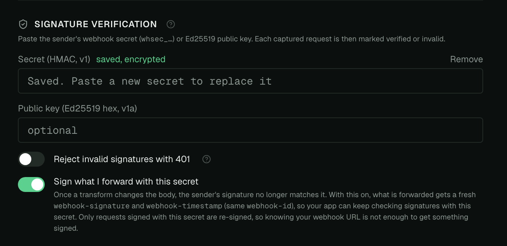
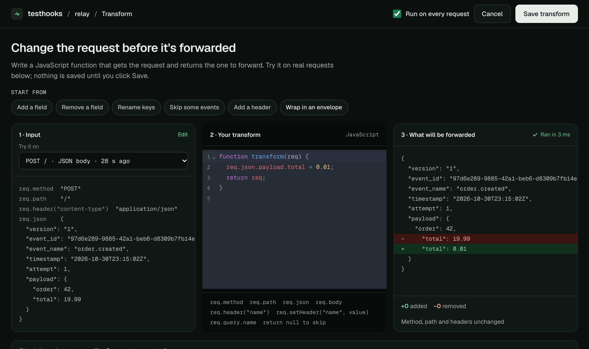
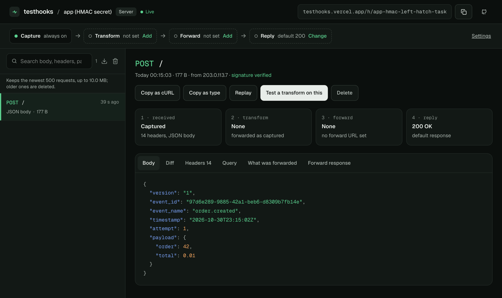
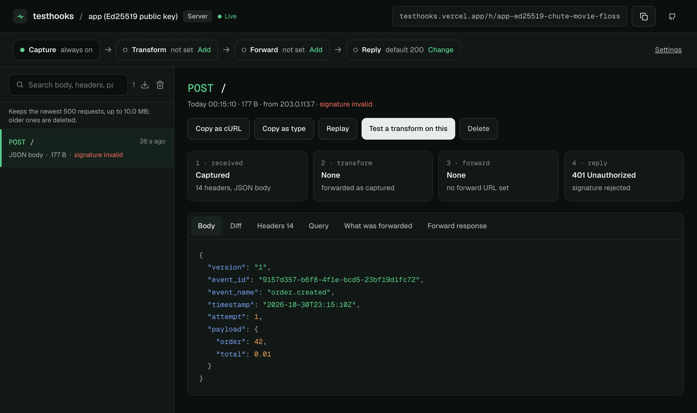

Most webhooks are signed with HMAC-SHA256: the sender and the receiver share a secret, and the receiver checks that the signature matches the body. It is a good check, but it has one property that is easy to forget. **The key that verifies is the key that signs.** Every receiver holds it, and so does every tool it was pasted into while debugging. Any of them can produce a valid signature for any body.

Here is how little that takes.

## Changing a signed webhook in three lines

[Testhooks](https://testhooks.vercel.app/) is a free webhook tester. Give an endpoint the webhook's secret and it verifies incoming signatures. It can also transform a request before forwarding it and, with one switch, **sign what it forwards** with the same secret, so the next hop still verifies it.



That feature is meant for testing transforms against a real receiver. It also shows the problem clearly. We pointed a Sparrow webhook at a Testhooks endpoint, gave it the webhook's secret, and wrote this transform:

```js
function transform(req) {
  req.json.payload.total = 0.01;
  return req;
}
```



Testhooks forwards the changed delivery with a fresh `v1` signature. An app that checks HMAC with the same secret sees an order total of `0.01`, **signature verified**:



Nothing was broken here. HMAC did what it promises: someone holding the secret signed these bytes. The problem is who holds the secret.

## Sparrow's answer: a key the receiver cannot sign with

Sparrow can sign each webhook with **Ed25519** as well. Sparrow keeps the private key; the receiver gets only the **public key**, which can check a signature but cannot make one. Turn it on when you register the webhook:

```bash
curl -X POST http://localhost:8080/v1/consumers/default/webhooks \
  -H 'Content-Type: application/json' \
  -d '{"url": "https://receiver.example.com/webhook",
       "events": ["order.created"],
       "signature_type": "ed25519"}'
# -> "signing_public_key": "89a0b318...f5c6"
```

Deliveries then carry an Ed25519 signature (`v1a,`) next to the HMAC one. HMAC receivers keep working, and a receiver that checks `v1a` with the public key gets the stronger guarantee.

We repeated the experiment with that receiver: same delivery, same transform, same relay holding the secret. This time the app had only the public key:



`401`, `no v1a signature in webhook-signature header`. The relay could re-sign with the secret, but it has no private key, so it cannot produce a `v1a` at all. Neither can the receiver, or anyone who copies the receiver's config. Only Sparrow can.

## What to do

1. **Register webhooks with `"signature_type": "ed25519"`** when the receiver should never be able to sign, and verify `v1a` with the public key. Sparrow's Go helper does it in one call: `signature.VerifyEd25519(body, r.Header, publicKeyHex)`.
2. **Reshape payloads in Sparrow, not in the middle.** Sparrow's [transforms](/sparrow/guides/payload-transformation/) run before signing, so the receiver verifies exactly what it gets and no hop needs a key.
3. **Keep the usual checks:** verify the raw body, reject old timestamps, and deduplicate on `webhook-id`.

To try it yourself, create an endpoint on [Testhooks](https://testhooks.vercel.app/), paste a webhook's secret or public key into **Settings → Signature Verification**, and send it a delivery. Sparrow's [verification guide](/sparrow/guides/verify-signatures/) has receiver code for both schemes in Go, Python, Node and Java.
