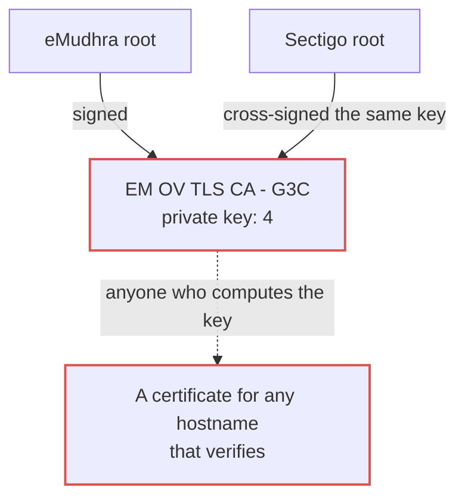
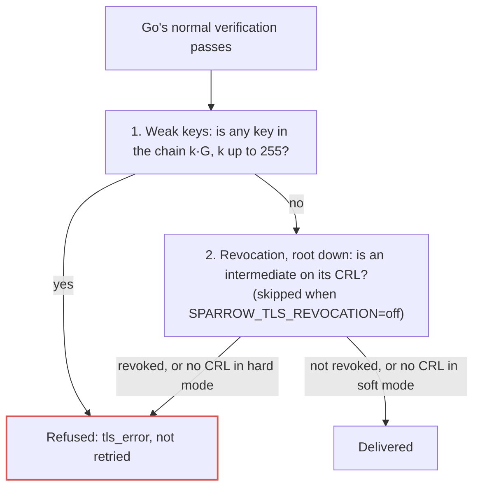

On 17 October 2026 a researcher reported that eight intermediate certificates issued by eMudhra, a CA trusted by every major browser, had private keys anyone could calculate ([Mozilla bug 2083449](https://bugzilla.mozilla.org/show_bug.cgi?id=2083449)). One of them, `EM OV TLS CA - G3C`, had the private key **4**.

Six of the eight issue TLS certificates. Whoever holds those keys can mint a certificate for any hostname, and it will verify.

> [!NOTE]
> **TLS trust in one minute.** When your code connects to `hooks.slack.com`, the server sends a short chain of certificates. The **leaf** says "this key belongs to hooks.slack.com". It is signed by an **intermediate**, which is signed by a **root** your machine already trusts. Intermediates do the day-to-day signing, so whoever holds an intermediate's private key can vouch for any website.
>
> When a key leaks, the CA **revokes** the certificate by publishing it on a **CRL**, a small signed list of certificates that should no longer be trusted. Browsers check those lists. Go doesn't.

## A one-byte secret

An ECDSA public key is *Q = d·G*: a secret number *d* times a fixed, public point *G*. It is safe only because *d* is picked from about 2^384 values on P-384. eMudhra's keys were 47 zero bytes and one meaningful byte. To recover one, compute *1·G*, *2·G*, *3·G*… and compare with the certificate. For `G3C` you stop at four.

```text title="Two P-384 private keys, 48 bytes each" {7}
a random key   3ae5170635529129d8adb99f19dd36fb
               299b95442d648084423db6630e7f0c81
               f5f83da433d250af5d746cd45bdfad5d

G3C's key      00000000000000000000000000000000
               00000000000000000000000000000000
               00000000000000000000000000000004
```

The cause, in eMudhra's account: during an April 2025 key ceremony, a script added to test key wrapping created a second, weak set of keys. Their labels looked like the real ones, and the weak keys were used for the certificate requests. eMudhra's root signed them, and Sectigo cross-signed them.

Nothing downstream could notice. Validation checks signatures, and the signatures were valid. A public key of *4·G* looks as random as any other point.



## Browsers were safe within hours. Go never was.

Mozilla pushed the certificates to OneCRL within about three hours, eMudhra and Sectigo revoked them within a day, and browsers are dropping the `emSign ECC Root CA - G3` root.

None of that reaches a Go program:

- **`crypto/x509` checks no revocation.** No CRLs, no OCSP, no OneCRL. A revoked certificate verifies exactly like a valid one.
- **The root store lags.** Sparrow's image is built on `distroless/static-debian12`. Its latest digest still ships the G3 root, so rebuilding changes nothing until Debian updates `ca-certificates`.
- **Cross-signs outlive the root.** Sectigo's copies of the same keys chain to Sectigo roots that stay trusted.

That is not specific to Go: most server software built on OpenSSL or Java is in the same position. A webhook server is the worst case: its whole job is opening TLS connections to other people's servers and handing them your data.

## What Sparrow does now

Two checks run after Go's normal verification, on every outbound connection that verifies TLS.



**1. Refuse the weak keys.** On first use, Sparrow computes *k·G* for *k* from 1 to 255 on P-256, P-384 and P-521, and refuses any chain containing one of those keys. It matches on the x-coordinate, so the equally trivial *(n − k)·G* is caught too, and it matches keys, not certificates, so Sectigo's cross-signs are caught as well. It needs no network, costs about 80 ms once and about 1.4 µs per handshake, and cannot reject a properly generated key: the odds are about 2^-376. It targets this incident, not weak keys in general.

**2. Check revocation.** Every intermediate in the chain is checked against the CRL its issuer publishes. That is what would have caught this incident without anyone noticing it, and it will catch the next one too.

- **Intermediates only.** Their CRLs are small and rarely change, and an intermediate is where a CA key lives. Leaf CRLs are large and change daily, and OCSP is being retired.
- **No schedule, no database.** Each instance caches CRLs in memory. The first connection that needs one downloads it. Once it is older than `SPARROW_CRL_MAX_AGE` (6h), the next connection refreshes it in the background. `POST /v1/tls/crls:refresh` refreshes every instance at once through a Postgres `NOTIFY`.
- **CRL addresses are attacker input.** They come from certificates the remote server sends. Downloads go through Sparrow's SSRF policy, and the chain is checked from the root down, stopping at the first revoked intermediate. A CRL address an attacker wrote into a certificate signed with a stolen key is never fetched: the stolen key's own certificate is revoked first.
- **Soft by default.** `SPARROW_TLS_REVOCATION=soft` lets a delivery through when its CRL can't be downloaded and shows why in `GET /v1/tls/crls`; `hard` refuses it. A revoked intermediate is refused either way.

A refused delivery fails with `tls_error`, is not retried, and names the certificate.

## Use it in your own Go code

Both checks live in [`github.com/sarathsp06/sparrow/pkg/safetransport`](https://github.com/sarathsp06/sparrow/tree/main/pkg/safetransport): a standalone module with no dependencies outside the standard library, so importing it does not pull in Sparrow. It is tagged with each Sparrow release.

```sh
go get github.com/sarathsp06/sparrow/pkg/safetransport
```

Weak-key check only, no network access:

```go
client := &http.Client{Transport: safetransport.New()}
```

With CRL checks for intermediates:

```go
rc := safetransport.NewRevocationChecker(safetransport.RevocationOptions{})
client := &http.Client{Transport: rc.Transport()}
```

Building your own transport? Set `TLSClientConfig: rc.TLSConfig()`, or plug `rc.VerifyConnection` into an existing `tls.Config`. Errors wrap `safetransport.ErrWeakKey`, `ErrRevoked` and, in hard mode, `ErrRevocationUnknown`, for `errors.Is`.

Two things to set on a server. `RevocationOptions.Client` should enforce your SSRF policy, since CRL addresses come from remote servers. And `Refresh(ctx)` downloads every cached CRL immediately, for when a revocation can't wait for `MaxAge`.

## What to take from it

- **Key strength is decided at generation.** A P-384 key with a one-byte secret is a one-byte secret: Debian's OpenSSL bug in 2008 and ROCA in 2017 were the same failure.
- **Bind identity to the key.** Compare fingerprints at every hand-off, never labels.
- **Revocation only protects clients that check it.** If your Go code talks TLS from a server, the browser ecosystem's fixes won't reach you unless you add them.

## But what does it cost?

Fair question. "Download a file from a CA during the TLS handshake" sounds like something that would make every webhook slow. So we pointed the checker at the kinds of receivers Sparrow talks to every day and measured.

The first surprise is how small these files are. A CA revokes an intermediate maybe a few times a decade, so the lists that track them are tiny:

| CRL | Used by | Size | Download |
|---|---|---|---|
| SSL.com TLS ECC (two) | example.com | 300 bytes each | 20 ms |
| Let's Encrypt (four) | Slack, letsencrypt.org | 283–808 bytes | 20–39 ms |
| Google Trust Services R4 | Discord, Google | 529 bytes | 22 ms |
| Sectigo E46 | GitHub API | 369 bytes | 36 ms |
| DigiCert Global Root G2 | PagerDuty | 2.1 KB, the biggest, 33 entries | 28 ms |

That is smaller than most webhook payloads, served from a CDN, and fetched in about the time of one round trip.

The second is how rarely you pay even that. A CRL is downloaded once per instance and then lives in memory for six hours, after which the next delivery refreshes it in the background without waiting. A busy Sparrow talking to a hundred receivers might use ten different CRLs. So, a few times a day, one delivery per CA takes 20 to 40 milliseconds longer. Every other delivery pays for a map lookup.

Lined up against the alternative, the trade is not close. Without the check, a stolen CA key works against Sparrow until a Debian package update reaches your image, and through the cross-signed copies for as long as they stay valid. With it, a revocation that browsers act on within hours reaches every Sparrow instance within six hours, or within seconds if someone calls `POST /v1/tls/crls:refresh`. All of that for a few kilobytes and a few tens of milliseconds, a handful of times a day.

> [!TIP]
> The one case where it costs more is a CRL server that is down or unreachable, as it will be on installs with no internet access. Then the first connection that needs that CRL waits up to five seconds, once, and carries on in soft mode. If that is your setup, `SPARROW_TLS_REVOCATION=off` skips the wait, and the weak-key check keeps working without any network at all.

*Measured on 21 October 2026 from a laptop in Europe; a server in a data center will usually be faster.*

---

> [!IMPORTANT]
> Both checks ship in the next Sparrow release; nothing needs configuring. CRL checks need outbound access to the CAs' CRL servers. Receivers whose chains go through a revoked intermediate, including these keys, will fail with `tls_error` until they get a new certificate. Details are in the [changelog](https://github.com/sarathsp06/sparrow/blob/main/CHANGELOG.md) and the [security reference](/sparrow/reference/security/#certificate-revocation).
