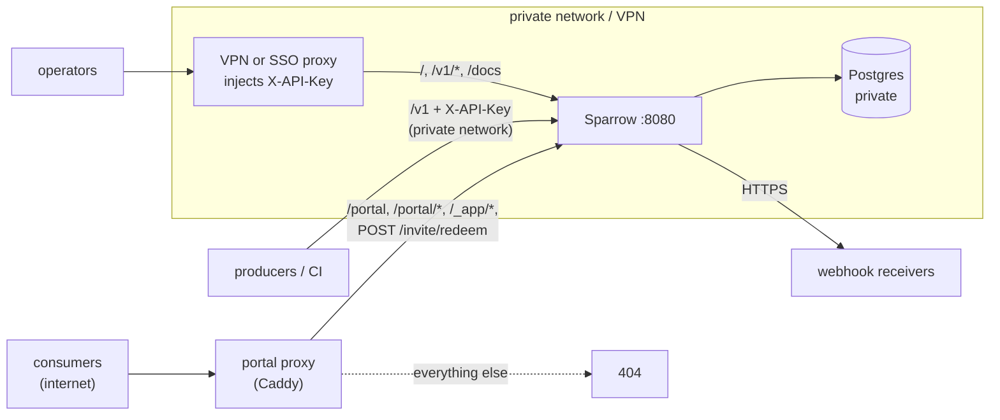
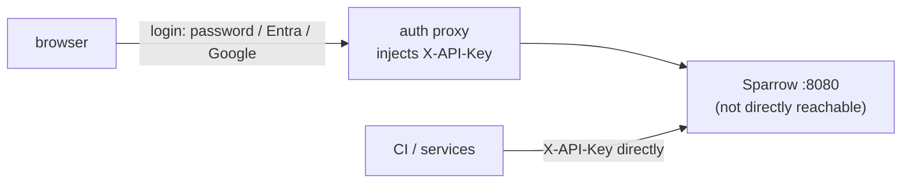

Sparrow's built-in authentication is deliberately minimal: a master key
(`SPARROW_API_KEY`, optional in development, required when
`SPARROW_ENVIRONMENT=production`) plus named, revocable
[access tokens](/sparrow/deployment/access/) minted from it. A token is either
tenant-wide (the same power as the master key) or scoped to one consumer's
portal. All of them are bearer secrets: Sparrow knows *which credential* made a
request, not *who* holds it. Per-user logins, SSO, MFA and an audit of who did
what are a deployment concern, solved by putting an identity-aware proxy in
front of Sparrow rather than by building an identity provider into it.

This page covers what Sparrow does natively, what it assumes about your
network, and the recommended way to add real user authentication. For the
implementation details -- SSRF protection, HTTP hardening headers, secret
masking, tenant isolation -- see the [Security
Model](/sparrow/reference/security/) reference page.

## What Sparrow provides natively

| Control | Mechanism |
|---|---|
| API authentication | `SPARROW_API_KEY` (master key) or per-person [access tokens](/sparrow/deployment/access/) → `X-API-Key` or `Authorization: Bearer` header; master key mandatory in production |
| Secrets at rest | Envelope encryption (AES-256-GCM, per-record DEK) keyed by the `SPARROW_ENCRYPTION_KEYS` keyring |
| Outbound signing | Standard Webhooks signatures on every delivery: `v1` HMAC-SHA256, plus `v1a` Ed25519 for webhooks with `signature_type: ed25519` |
| SSRF protection | Private/loopback/link-local/metadata IPs blocked at connect time in every mode; cloud metadata endpoints stay blocked even with `SPARROW_ALLOW_PRIVATE_NETWORKS=true`, but an explicit `SPARROW_ALLOWED_NETWORKS` entry can reach them; redirects re-validated |
| Custom header validation | Header names must be valid HTTP tokens; values reject CR/LF/control chars and are capped at 8 KiB; reserved framing headers (`Host`, `Content-Length`, `Transfer-Encoding`, `Connection`, `Keep-Alive`, `Proxy-Connection`, `TE`, `Trailer`, `Upgrade`) are refused; Sparrow's own signature and ID headers always win over custom headers |
| Portal path validation | The portal gateway rejects paths containing `.`, `..`, empty segments, backslashes, or control characters (`403`) |
| Browser access | `SPARROW_CORS_ALLOWED_ORIGINS` allowlist; security headers on all responses |

What it does **not** provide:

- **User accounts.** [Access tokens](/sparrow/deployment/access/) give each person and machine their own credential, but identity is possession-based — there are no accounts, passwords, or MFA.
- **Tenant isolation via consumers.** Consumers organize resources; they are
  *not* a security boundary for the admin API. The master key and every
  tenant-wide token can read and write every consumer. Only consumer-scoped
  (portal) tokens are limited to one consumer, and only through `/portal/api`.
- **Rate limiting on the API.** Put a reverse proxy in front if you need it.

## Data retention and compliance posture

Sparrow stores event payloads and delivery request bodies as **plaintext in
PostgreSQL** — they must stay queryable and transformable. Secrets and
signing keys are envelope-encrypted; payloads are not. If payloads carry
regulated data (PHI, PII), plan for it:

- **Encrypt at the storage layer.** Encryption-at-rest requirements
  (HIPAA-style) are satisfied below the application: encrypted
  disks/volumes, or the managed encryption RDS/Cloud SQL enable by default,
  plus TLS to PostgreSQL.
- **Bound how long data lives.** Set `SPARROW_EVENT_RETENTION_DAYS` to purge
  events — and, via cascade, their deliveries — older than N days. Runs
  hourly in the background. Unset (the default), data is kept forever.
- **Keep response capture off.** `capture_response_body` is off by default;
  leave it off if endpoints may echo sensitive data back.
- **Self-hosting is the compliance boundary.** Payloads never leave your
  infrastructure — there is no vendor to sign a BAA with.

## Trust model of the embedded dashboard

The embedded web UI (`SPARROW_SERVE_UI=true`) is designed for **trusted,
private networks** — a team dashboard on a VPN or internal network, not a
public-facing app:

- The dashboard and its assets are served **without authentication** so the
  login-free UI works out of the box.
- The dashboard needs a credential to call the API. When `SPARROW_API_KEY` is
  set, the UI shows a **Sign in to Sparrow** prompt on the first `401`. A
  pasted master key is exchanged for a browser token so the master key is
  never stored. Access tokens and invite links also work. The server never
  writes the API key into the served HTML.
- A [separately hosted UI](/sparrow/deployment/separate-ui/) behaves the same
  way by default. An `apiKey` in its `config.js` skips the prompt, but anyone
  who can load the UI can read the key.
- To give a teammate access, create an invite (`sparrow invite alice`) instead
  of pasting the key into chat. The invite link lives in the URL fragment, so
  it never reaches server or proxy logs. It works once, expires (default 24
  hours, max 7 days), and creates a named token the invitee can use. The
  invite can be cancelled before use; the resulting token can be revoked at any
  time. See [Access: Tokens and Invites](/sparrow/deployment/access/) for the
  full guide.

Consequences:

- On a private/VPN network where everyone with network access is trusted:
  fine as-is.
- On a shared or internet-facing network: **do not expose the port directly.**
  Put an authenticating proxy in front (next section) or disable the UI.

## The consumer portal

The portal (`/portal`) uses a different trust model: each visitor carries a
**portal token** — an
expiring, revocable, consumer-scoped access token minted with the admin key
(`POST /v1/tokens` with a `consumer`). Portal users never log in and
need no accounts; the magic link *is* the credential, and it can only touch
that one consumer's webhooks, subscriptions, and deliveries (never event
injection, other consumers, or admin routes). The `/portal` HTML is served
**without** the admin API key, and its framing headers allow embedding in
an iframe. See the [security reference](/sparrow/reference/security/#portal-tokens)
for the exact scope.

How that plays out per network topology:

- **Sparrow on a VPN, consumers internal too** — works as-is. Hand teams
  portal links instead of dashboard access: they manage their own endpoints
  without ever holding the admin key.
- **Sparrow on a VPN, consumers external** — expose only the portal slice
  through your reverse proxy and keep everything else private:

  ```mermaid
  flowchart LR
      accTitle: Portal slice topology
      accDescr: Portal slice topology: the internet reaches a proxy (TLS and rate limiting) that forwards only /portal, /_app/*, and the single bearer-scoped /portal/api/* prefix to Sparrow, denying everything else; a separate VPN path reaches Sparrow :8080 for the admin UI, full API, and token minting.
      Net[internet] --> Proxy["proxy<br>TLS + rate limit"]
      Proxy -->|"/portal, /portal/*, /_app/*"| S["Sparrow :8080"]
      Proxy -->|"/portal/api/* — bearer-scoped, all portal API"| S
      Proxy -->|everything else| Deny[deny]
      VPN["VPN (admin)"] -->|"admin UI, full API, token minting"| S
  ```

  `SPARROW_API_KEY` **must** be set in this topology — without it the auth
  middleware is disabled and the exposed paths are open to everyone. The
  "proxy" can be a standalone reverse proxy **or your own product's
  backend** forwarding those routes over the VPN — same origin as your app,
  so no CORS setup and no iframe required. Two constraints: paths must be
  preserved verbatim (`/portal`, `/portal/*`, `/_app` are root-absolute in
  the SPA — use a dedicated subdomain if they collide with your app's routes),
  and the proxy forwards nothing beyond them: above all not `/v1` with an
  injected admin `X-API-Key`.
- **Embedded in your own product** (the intended design) — your app is
  already public and already authenticates its users. Its backend calls the
  mint endpoint over the private network and renders the returned
  `/portal#token=...` path in an iframe (or links to it via the proxy
  above). Sparrow delegates identity entirely to your product; the portal
  slice above is the only thing that needs to be reachable from the user's
  browser.

What does **not** work: fetching `/portal` HTML server-side and inlining it
into your own pages. The portal is a single-page app — the HTML is only a
shell whose scripts and API calls (`/_app/*`, `/portal/api/*`) run from the
**visitor's browser** and must reach Sparrow through one of the routes above.
Copying the HTML copies neither. If you want zero Sparrow UI in the browser,
build your own screens on the consumer-scoped REST API instead: your backend
holds the token, calls Sparrow over the VPN, and renders native components.

A full worked example of the external topology — a Caddy proxy config, a
Docker Compose stack that runs it, the mint flow, and the threat analysis —
is in [Embedding the Consumer Portal](/sparrow/guides/portal-embedding/).

Portal caveats: the token rides in the URL fragment, so anyone the link is
forwarded to can use it until it expires (default 7 days, max 30 — use a short
`ttl_seconds` for embedding) or you revoke it with `DELETE /v1/tokens/{id}`.

For named individuals, `sparrow invite "acme support" --consumer acme` creates
a one-time link that opens the portal and grants a named token of the same
kind. See [Access: Tokens and
Invites](/sparrow/deployment/access/#consumer-portal-access).

## Recommended: SSO via an identity-aware proxy

For per-user login — username/password, Microsoft Entra ID, Google, or any
OIDC/SAML provider — run an open-source auth overlay in front of Sparrow. The
proxy authenticates humans, then injects the `X-API-Key` header on every
authenticated request. Sparrow needs zero configuration changes beyond setting
the key, and the browser never sees the key at all.

### What must be private, and what can be public

Sparrow is one process on one port (`:8080`), but its routes fall into three
groups with different exposure. Decide per group, not per port:

| Route | Who needs it | Exposure |
|---|---|---|
| Postgres | Sparrow only | **Private.** Never published; only Sparrow connects. |
| `/` (dashboard), `/_app/*` for it, `/docs`, `/openapi.*` | your operators | **Behind SSO or the VPN.** The dashboard has no login of its own beyond the key prompt. |
| `/v1/*` | operators (via the SSO proxy), your producers and CI (`X-API-Key`) | **Behind SSO or the VPN.** Producers push events here and your backend mints portal tokens here, so it must be reachable from them, not from the internet. |
| `/health`, `/ready`, `/metrics` | your orchestrator and monitoring | **Private.** Unauthenticated by design; `/metrics` shows per-webhook traffic. |
| `/portal`, `/portal/*` (incl. `/portal/api/*`), `/_app/*`, `/favicon.png` | your consumers' browsers | **Can be public.** Every API call needs a consumer-scoped bearer token; the gateway pins it to one consumer. |
| `POST /invite/redeem` | whoever holds an invite link | **Can be public** if you hand out consumer invites; the single-use invite is the credential. |
| Outbound HTTPS to receivers | Sparrow | **Egress only.** Sparrow must reach webhook URLs; nothing needs to reach Sparrow for that. |

Two rules hold in every layout: set `SPARROW_API_KEY` (without it `/v1` is
open to anyone who can reach the port), and forward nothing to the public
side beyond the "can be public" rows (rule 4 below).

[`deploy/portal/`](https://github.com/sarathsp06/sparrow/tree/main/deploy/portal)
in the repository is this table as a runnable Docker Compose stack:



In that stack:

- `postgres` and `sparrow` sit only on the `private` network; Postgres
  publishes no port.
- `portal-proxy` (Caddy) is the only service on the `public` network. Its
  `Caddyfile` forwards the "can be public" rows and answers 404 to the rest;
  `http://localhost:8181/v1/webhooks` and `/docs` are 404 from Caddy.
- Sparrow's own port is published on `127.0.0.1:8180` only. That line
  stands in for "reachable over the VPN": in production, replace it with your
  VPN, or with the identity-aware proxy from this section on the private
  network, published on an internal hostname.

### Rules for the SSO proxy



1. Sparrow's port must be reachable **only** from the proxy (and trusted
   machine clients). If clients can bypass the proxy, the overlay is decoration.
2. Set `SPARROW_API_KEY`; give it only to the proxy config and machine clients.
3. Set `SPARROW_CORS_ALLOWED_ORIGINS` to the proxy's public origin (or leave unset if
   the UI is served through the same origin).
4. **Serve the portal on its own vhost, as `deploy/portal/` does, not as a
   login-free exception on the SSO proxy.** The SSO proxy injects the admin
   key, so any path it lets through without a login is an admin route for
   anyone, and an exception list is easy to widen by mistake. On the portal
   routes themselves an injected key changes nothing (portal calls stay
   pinned to the token's consumer); the danger is everything next to them.

### Option A — Authentik (username/password + Entra + Google in one tool)

[Authentik](https://goauthentik.io) is a self-hosted identity provider with a
built-in **Proxy Provider** mode, so it is both the IdP and the overlay:

- Local user database (passwords, passkeys, MFA) **and** federated sources
  (Microsoft Entra ID, Google, generic OIDC/SAML) side by side.
- Proxy Provider runs as an embedded outpost or standalone container; speaks
  forward-auth natively with Traefik, nginx, and Caddy.
- In the Proxy Provider settings, add a custom header injection so every
  proxied request carries `X-API-Key: <SPARROW_API_KEY>`.

Deployment: two containers (server + worker) plus PostgreSQL — you already run
PostgreSQL for Sparrow. Verify that the external OAuth/SAML source types you
need are available in the open-source tier of your Authentik version.

### Option B — oauth2-proxy (single IdP, smallest footprint)

If **all** users live in one IdP (an Entra tenant or a Google Workspace
domain), [oauth2-proxy](https://github.com/oauth2-proxy/oauth2-proxy) is a
single Go binary that does the whole job:

```text
oauth2-proxy \
  --provider=oidc \
  --oidc-issuer-url=https://login.microsoftonline.com/<tenant>/v2.0 \
  --upstream=http://sparrow:8080 \
  --email-domain=yourcompany.com
```

Inject the API key upstream via its header configuration (e.g. an
`injectRequestHeaders` entry in the alpha config, or terminate at nginx and add
`proxy_set_header X-API-Key ...`). No local username/password support — that's
the tradeoff for the small footprint.

### Option C — Keycloak + oauth2-proxy (maximum boring)

[Keycloak](https://www.keycloak.org) if you want the battle-tested enterprise
IdP: local users, identity brokering (Entra, Google, SAML), fine-grained roles
— all free. Keycloak is only the IdP; pair it with oauth2-proxy (pointing at
Keycloak as its OIDC issuer) as the actual overlay. Two moving parts instead
of one, but every part is thoroughly documented and widely deployed.

### Not a fit

- **Authelia** — local users only; it [cannot consume external OIDC
  providers](https://www.authelia.com/configuration/identity-providers/openid-connect/provider/)
  (no Relying Party role), so no "login with Entra/Google".
- **Pomerium** — excellent identity-aware proxy, but delegates to a single
  upstream IdP and has no built-in username/password store.

## Hardening checklist

Whether or not you add SSO:

- [ ] Set `SPARROW_API_KEY` (generate: `openssl rand -hex 32`, at least 32
      characters) — mandatory when `SPARROW_ENVIRONMENT=production`, and without it
      anyone who can reach the port owns the instance regardless of environment.
- [ ] Set `SPARROW_ENVIRONMENT=production`. Any other value (`prod` included) runs
      as development: no key required, CORS open to every origin when
      `SPARROW_CORS_ALLOWED_ORIGINS` is unset, and the all-zeros key accepted.
- [ ] Configure `SPARROW_ENCRYPTION_KEYS` and `SPARROW_ENCRYPTION_PRIMARY_KEY_ID`, and store the key material in a secret manager, never in
      the database or repo.
- [ ] Use TLS to PostgreSQL (`sslmode=require` or stronger) whenever the
      database is not on localhost.
- [ ] Set `SPARROW_CORS_ALLOWED_ORIGINS` explicitly for any browser-based access.
- [ ] Use `SPARROW_ALLOWED_NETWORKS` (comma-separated CIDRs) to reach internal
      webhook targets instead of `SPARROW_ALLOW_PRIVATE_NETWORKS=true`. Cloud
      metadata endpoints stay blocked with either setting unless an
      `SPARROW_ALLOWED_NETWORKS` entry explicitly covers them.
- [ ] Set `SPARROW_EVENT_RETENTION_DAYS` if payloads carry regulated data or
      you have any retention policy — the default keeps events forever.
- [ ] Terminate TLS and apply rate limiting at a reverse proxy; Sparrow serves
      plain HTTP.
- [ ] Confirm the server never writes `SPARROW_API_KEY` into the UI (this is
      now the default -- the server no longer supports key injection).
- [ ] Give people and CI jobs their own [access tokens](/sparrow/deployment/access/)
      instead of sharing `SPARROW_API_KEY`. Use invites for people, direct
      token creation for machines.
- [ ] Plan webhook secret rotations with the receiver's owner: `:rotateSecret`
      has no overlap window, so deliveries signed with the new secret fail
      verification until the receiver is updated. See
      [Webhook Secret Rotation](/sparrow/reference/security/#webhook-secret-rotation).
- [ ] Revoke tokens when someone leaves or a machine credential is retired
      (`sparrow tokens revoke <id>` or `DELETE /v1/tokens/{id}`).
- [ ] Keep `/health`, `/ready`, `/metrics`, `/docs`, and `/openapi.*` in mind:
      they are intentionally unauthenticated. `/metrics` (Prometheus scrape,
      on by default via `SPARROW_METRICS_ENABLED`) exposes aggregate counters
      whose labels include receiver host names -- firewall it or disable it if
      the data is sensitive. Restrict the others
      at the proxy if the OpenAPI spec is sensitive in your environment.
