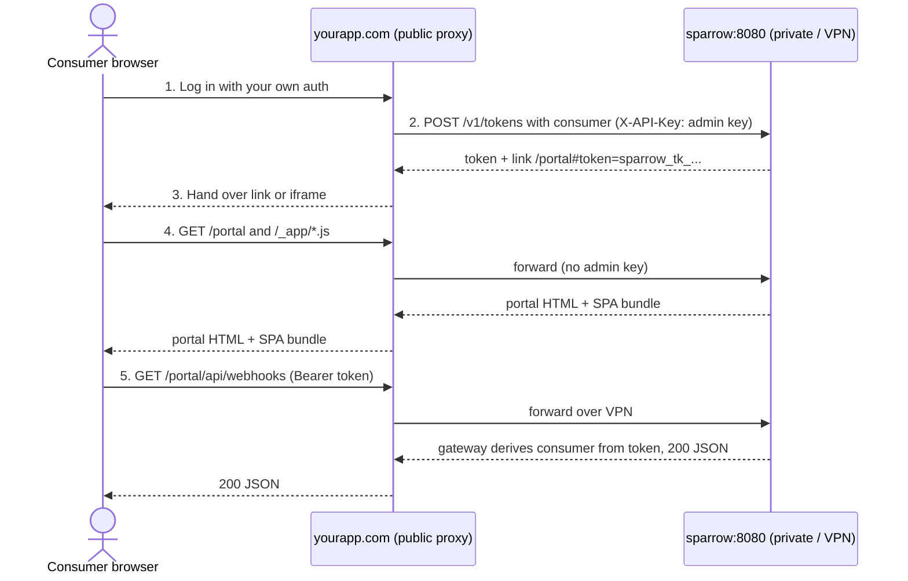
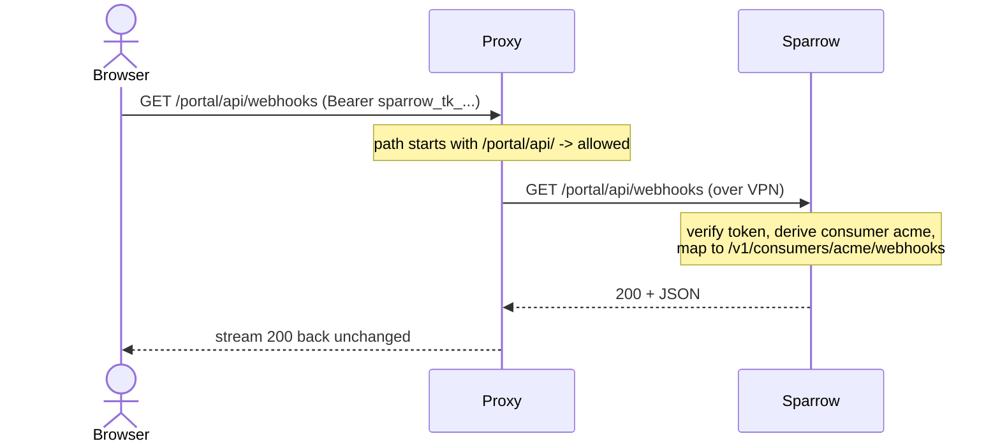

Sparrow's consumer portal (`/portal`) lets each consumer manage their own
webhooks, subscriptions, and deliveries with a scoped, expiring **portal
token** instead of the admin API key. This guide shows the recommended way to
serve it to **external users while Sparrow itself stays VPN-only**: your
product's public app acts as a forwarding proxy for exactly the routes the
portal needs — nothing else.

The result: the visitor's browser only ever talks to *your* domain, Sparrow
is never directly reachable from the internet, and the only credential in the
browser is a token that can touch one consumer and nothing more.

## How it works, end to end



1. **Your app authenticates the user** with whatever login it already has.
   Sparrow plays no part in identity — it never needs user accounts.
2. **Your backend mints a token** over the private network:

   ```bash
   curl -s -X POST http://sparrow:8080/v1/tokens \
     -H "X-API-Key: $SPARROW_API_KEY" -H "Content-Type: application/json" \
     -d '{"name": "portal", "consumer": "acme", "ttl_seconds": 3600, "external_id": "user-42"}'
   # → { "token": { "id": "tok_...", "expires_at": "...", ... }, "secret": "sparrow_tk_...",
   #     "reused": false, "portal_path": "/portal#token=sparrow_tk_...&consumer=acme&expires=..." }
   ```

   This is the **only** call that uses the admin key, and it happens
   server-to-server — the key never crosses the network boundary. The link
   is a consumer-scoped access token (the same kind `sparrow tokens create
   --consumer` makes): pick a short `ttl_seconds` (the default is 7 days),
   and revoke it early with `DELETE /v1/tokens/{id}`.
   `external_id` is your id for who the link is for (your user id, say).
   There is at most one active token per consumer and `external_id`, which
   makes the call safe to repeat on every page view: while that user's link
   is valid, Sparrow returns the same token (`"reused": true`) instead of
   minting another, and mints a fresh one once it has expired or been
   revoked.
3. **Your app hands the link to the browser** — redirect to
   `https://yourapp.com/portal#token=...`, or render it in an `<iframe>`
   (the portal's headers permit framing; the rest of Sparrow forbids it).
   The token rides in the URL *fragment*, which browsers never send in HTTP
   requests — it stays out of your proxy's and Sparrow's access logs.
4. **The browser loads the portal through your proxy.** The HTML and JS
   bundle come from Sparrow via the forwarded routes. Portal HTML is served
   *without* the admin API key (neither the portal nor the dashboard receives it).
5. **The portal calls the API through the same proxy**, under the single
   `/portal/api/` prefix, sending `Authorization: Bearer <token>` on every
   request. Sparrow's portal gateway looks the token up (by its SHA-256 hash,
   cached for 30 seconds), checks it is active, derives the consumer *from
   the token* (never the URL), and
   maps `/portal/api/<rest>` to that consumer's real route — so cross-consumer
   access is structurally impossible, and event injection and token minting
   are refused. No token, bad token, or a denied action is a 401/403.

## What "forwarding" actually means

The proxy is not copying files or caching pages — it is an ordinary program
(nginx, Caddy, or your own backend) that sits on a machine with a foot in
**both** networks: the internet can reach it, and it can reach Sparrow over
the VPN/private network. For every incoming request it does four things:

1. **Match the path** against the allowlist below. No match → respond 404
   itself; Sparrow is never contacted.
2. **Open its own connection** to `sparrow:8080` over the private network.
3. **Replay the request** — same method, same path, same headers (including
   the `Authorization: Bearer` token), same body.
4. **Stream Sparrow's response back** to the browser unchanged.

Trace one real request through it:



The browser never learns Sparrow's address, never joins the VPN, and never
holds anything but the scoped token. To the browser the portal simply *is*
`hooks.yourapp.com`. And because HTML, JS, and API all arrive from that one
origin, no CORS configuration is needed anywhere.

### Prerequisites

- A machine (or container) that is publicly reachable **and** can open TCP
  connections to Sparrow on the private network — typically your existing
  app server or ingress, since it already sits in both worlds.
- A DNS name for it (`hooks.yourapp.com`) with a TLS certificate — Caddy
  below provisions one automatically.
- Sparrow reachable from that machine as `sparrow:8080` (substitute your
  real host/IP), with `SPARROW_API_KEY`, `SPARROW_ENCRYPTION_KEYS`, and
  `SPARROW_ENCRYPTION_PRIMARY_KEY_ID` set.
- `SPARROW_SERVE_UI=true` on a server built with the UI (the Docker image, or
  `make build-with-ui`). Without it `/portal` and `/_app/*` return 404 and only
  `/portal/api/*` works.

## The route allowlist

Forward exactly these routes (three required, invites and the favicon optional), deny everything else:

| Route | Why the portal needs it |
|---|---|
| `GET /portal`, `GET /portal/*` | the portal page itself, and its subscription pages (`/portal/webhooks/...`), which a browser reload requests directly |
| `GET /_app/*` | SPA JS/CSS bundle |
| `* /portal/api/*` | **every** portal API call — webhooks, subscriptions, deliveries, retries, and the read-only catalog/template helpers, all bearer-scoped to the token's consumer |
| `POST /invite/redeem` | only if you hand out consumer invite links (`/portal#invite=...`): exchanges the single-use invite for a portal token (optional) |
| `GET /favicon.png` | tab icon (optional) |

That single `/portal/api/*` prefix replaces every per-consumer and per-helper
`/v1` rule. You need **no deny rules**: the portal gateway derives the consumer
from the token, and refuses event injection itself. Token minting
(`POST /v1/tokens`), event injection, the
admin dashboard (`/`), the global `/v1` API, `/docs`, and `/openapi.*` are
simply never forwarded, so they stay unreachable from the internet.

Paths must be preserved **verbatim**: the portal page, its API prefix, and its
assets are root-absolute (`/portal`, `/portal/api`, `/_app`), so the portal
cannot be remounted under `/integrations/webhooks/`. If those roots collide
with your app's own routes, put the proxy on a dedicated subdomain
(`hooks.yourapp.com`).

## Serving the portal with Caddy

[Caddy](https://caddyserver.com) is the proxy we test the portal with: one
short file, and with a hostname it manages the TLS certificate itself
([automatic HTTPS](https://caddyserver.com/docs/automatic-https)). The configuration below is
[`deploy/portal/Caddyfile`](https://github.com/sarathsp06/sparrow/blob/main/deploy/portal/Caddyfile),
which the [Docker Compose stack](#try-the-whole-topology-locally) runs, with
`:80` replaced by a hostname.

### The Caddyfile

```text
hooks.yourapp.com {
	# The portal page, its subscription pages (/portal/webhooks/...), and its
	# API (/portal/api/*). The API is bearer-scoped by Sparrow's portal
	# gateway, so no deny rules are needed here.
	@portal path /portal /portal/* /_app/* /favicon.png
	handle @portal {
		reverse_proxy sparrow:8080
	}

	# Consumer invite links (/portal#invite=...) are exchanged here for a
	# portal token. Leave this block out if you only hand out portal links.
	@redeem {
		method POST
		path /invite/redeem
	}
	handle @redeem {
		reverse_proxy sparrow:8080
	}

	# Everything else, including /, /v1, /docs, /health and /metrics.
	respond 404
}
```

| Part | What it does |
|---|---|
| `hooks.yourapp.com {` | The public hostname, which turns on Caddy's automatic HTTPS (ports 80 and 443 must reach Caddy). The Compose stack uses `:80` instead: plain HTTP, for local testing or behind another TLS terminator. |
| `@portal path ...` | The allowlist. `/portal/*` covers the subscription pages and every API call under `/portal/api/`; `/_app/*` is the JavaScript and CSS bundle. |
| `handle @portal { reverse_proxy sparrow:8080 }` | Forwards matching requests unchanged: same path, method, headers (including the `Authorization: Bearer` token) and body. `sparrow:8080` is Sparrow's address on your private network. |
| `@redeem` + `handle @redeem` | `POST /invite/redeem` only. The single-use invite in the body is the credential; any other method gets the 404 below. |
| `respond 404` | Caddy answers everything else itself; Sparrow never sees the request. |

### Running it

Run Caddy wherever it can reach both the internet and Sparrow on the private
network. As a container, this is the `portal-proxy` service from
`deploy/portal/docker-compose.yml` with production ports:

```yaml
portal-proxy:
  image: caddy:2-alpine
  restart: unless-stopped
  networks: [private, public]     # the only service on both
  ports:
    - "80:80"                     # certificate challenges and the HTTPS redirect
    - "443:443"
  volumes:
    - ./Caddyfile:/etc/caddy/Caddyfile:ro
    - caddy_data:/data            # keeps certificates across restarts
```

Sparrow itself must not publish a port to the internet. In the Compose stack
it publishes only `127.0.0.1:8180`, standing in for "reachable over the
VPN"; your backend mints portal tokens and your producers push events
through that private side, never through Caddy.

### Checking it

These are the responses through the proxy in the Compose stack (`$T` is a
portal token from `./try.sh`). Run the same requests against your hostname
after deploying:

| Request through the proxy | Response | Why |
|---|---|---|
| `GET /portal`, `GET /portal/webhooks/<id>/subscriptions/new` | 200 | portal pages |
| `GET /portal/api/webhooks` without a token | 401 | the gateway needs a portal token |
| `GET /portal/api/webhooks` with `Authorization: Bearer $T` | 200 | that consumer's webhooks only |
| `POST /portal/api/events`, `POST /portal/api/events:rePush` | 403 | pushing and re-pushing events is the producer's job |
| `POST /invite/redeem` with an unknown invite | 400 | forwarded; the invite is checked by Sparrow |
| `GET /invite/redeem` | 404 | only `POST` is forwarded |
| `GET /`, `/v1/webhooks`, `/v1/tokens`, `/docs`, `/openapi.yaml`, `/health`, `/ready`, `/metrics` | 404 | from Caddy: not in the allowlist |
| `GET /v1/webhooks` with a valid `X-API-Key` | 404 | an admin key does not help from the public side |

```bash
curl -s -o /dev/null -w '%{http_code}\n' https://hooks.yourapp.com/v1/webhooks   # 404
curl -s -o /dev/null -w '%{http_code}\n' https://hooks.yourapp.com/portal/api/webhooks   # 401
```

### Mistakes to avoid

Each of these was tried against the Compose stack:

- **A bare `reverse_proxy @portal` next to `respond 404`** answers 404 to
  every request, `/portal` included: Caddy runs `respond` before
  `reverse_proxy` whatever their order in the file. Keep each
  `reverse_proxy` inside a `handle` block, as above.
- **`handle_path /portal/*`** strips the prefix, so `/portal/api/webhooks`
  reaches Sparrow as `/api/webhooks` and comes back as the dashboard's HTML
  with a 200. The portal then fails with `Unexpected token '<'`. Use
  `handle`, which forwards paths unchanged; if `/portal` collides with your
  own routes, give the portal its own hostname.
- **An injected admin key** (`header_up X-API-Key ...`) is not needed, and on
  these routes it changes nothing: portal calls stay pinned to the token's
  consumer, and a call without a portal token is still 401. Leave it out
  anyway. On any route beyond this allowlist, such as `/v1`, it would make
  every visitor an admin.

Sparrow does not limit request rates. If the portal faces untrusted
traffic, put a limiter in front of `/portal/api/`.

## Try the whole topology locally

[`deploy/portal/`](https://github.com/sarathsp06/sparrow/tree/main/deploy/portal)
runs everything on one machine, so you can see which side reaches what
before deploying:

| Service | Networks | Published | Stands in for |
|---|---|---|---|
| `postgres` | `private` | nothing | your database |
| `sparrow` | `private` | `127.0.0.1:8180` | Sparrow on your VPN: admin UI, `/v1`, token minting |
| `portal-proxy` (Caddy, the file above with `:80`) | `private`, `public` | `127.0.0.1:8181` | your public portal hostname |
| `receiver` | `private` | nothing | a consumer's webhook endpoint: `/hook` answers 200, `/fail` answers 410 |

```bash
cd deploy/portal
docker compose up -d
./try.sh     # webhooks, events and a portal link for consumer "acme"
```

Then:

1. **The public side.** Open the printed `http://localhost:8181/portal#token=...`
   link. The consumer sees both webhooks, their successful and failed
   deliveries, and can retry the failed ones. Every request in the browser's
   network tab goes to `/portal/...` or `/_app/...`.
2. **What the public side cannot reach.** Run the requests from
   [Checking it](#checking-it) against `http://localhost:8181`: the admin
   UI, `/v1`, `/docs` and the health endpoints are 404 from Caddy.
3. **The private ("VPN") side.** `http://localhost:8180` is the admin UI and
   API (key `local-admin-key`): the only place tokens are minted and events
   pushed.
4. **Retries off.** Restart Sparrow with the switch:
   `SPARROW_PORTAL_RETRY=false docker compose up -d sparrow`. The portal
   shows its Retry buttons disabled and the retry calls answer 403.
5. **A local build.** To test changes to Sparrow itself:
   `docker build -t sparrow:dev ../.. && SPARROW_IMAGE=sparrow:dev docker compose up -d`.

`docker compose down -v` removes everything. The admin key, the all-zeros
encryption key and `SPARROW_ALLOW_PRIVATE_NETWORKS` (for the demo receiver)
are local-only values; [Production
Deployment](/sparrow/deployment/production/) covers the real ones.

## Letting consumers retry

By default a consumer can retry its own failed deliveries from the portal
(one at a time, or the deliveries held while a webhook was paused). To keep
resending in your hands, start Sparrow with `SPARROW_PORTAL_RETRY=false`:

- the portal gateway answers `403` to `POST /portal/api/deliveries/{id}:retry`,
  `deliveries:retry` and `deliveries:retryBatch`;
- `GET /portal/api/capabilities` reports `portal.retry: false`, and the
  portal shows its Retry buttons disabled, with the reason;
- consumers still see every delivery and its attempts, and the master key
  and tenant-wide tokens can still retry on `/v1`.

Re-pushing events (`events:rePush`) is never available to portal tokens,
whatever this switch says: it fans events out again, in bulk, to the current
subscriptions, which is the producer's job like pushing them. To backfill a
consumer's new subscription, re-push from the admin side.

## Security analysis

What each party can and cannot do:

| Actor | Can | Cannot |
|---|---|---|
| Portal visitor with a valid token for `acme` | Manage `acme`'s webhooks/subscriptions, view `acme`'s deliveries and retry them (unless `SPARROW_PORTAL_RETRY=false`) | Read any other consumer, push or re-push events, mint tokens, reach the admin UI/API |
| Anyone hitting the public vhost without a token | Load the portal shell (renders "missing access link") | Call any API route — everything under `/portal/api` returns 401 |
| Someone who steals a portal link | Everything the legitimate holder can, until it expires or you revoke it | Escalate beyond that consumer |
| Your backend | Mint tokens for any consumer (it holds the admin key) | — (it is fully trusted; keep the key server-side) |

Why the pieces hold:

- **Token integrity** — a portal token is 256 random bits; Sparrow stores
  only its SHA-256 hash, together with the consumer and expiry. The
  `consumer` and `expires` in the link fragment are for display only —
  editing them changes nothing the server enforces.
- **Scope is enforced by Sparrow, not the proxy.** The consumer comes from
  the stored token, never the URL, so the portal gateway maps every
  `/portal/api` call to that consumer's own route and refuses minting and
  event injection — the proxy needs no deny rules and cross-consumer access
  is impossible even if the whole prefix is forwarded.
- **No admin key in the browser, ever.** The server never writes
  `SPARROW_API_KEY` into any served page (portal or dashboard), and the
  mint call is server-to-server. The fatal misconfiguration is a public
  vhost that forwards more than the allowlist, such as `/v1`, while
  injecting `X-API-Key`: whoever reaches it is an admin.
- **Fragment tokens don't leak into logs.** `#token=...` is never sent in
  HTTP requests; the portal moves it to `sessionStorage` and sends it only
  as an `Authorization` header over TLS.
- **Blast radius of a leaked link is bounded** by consumer + TTL, and you
  can cut it short: revoke the link's token id and it stops working
  within 30 seconds on every instance. With `external_id`, each of your
  users holds at most one live link per consumer; expired and revoked links
  are deleted from the database a week later by a daily purge.
- **Reusable links are stored encrypted.** To hand the same link back,
  Sparrow keeps the secret of a token minted with an `external_id`,
  envelope-encrypted with `SPARROW_ENCRYPTION_KEYS` like webhook secrets.
  Tokens minted without one are stored as a SHA-256 hash only. Revoking a
  token deletes its stored secret.

Checklist before going live:

- [ ] `SPARROW_API_KEY` set — with an empty key Sparrow's auth middleware is
      disabled and the forwarded slice would be wide open.
- [ ] `SPARROW_ENCRYPTION_KEYS` and `SPARROW_ENCRYPTION_PRIMARY_KEY_ID` configured and stored in a
      secret manager.
- [ ] `SPARROW_SERVE_UI=true`, so `/portal` is served.
- [ ] Proxy forwards **only** the allowlist; default route denies.
- [ ] No `X-API-Key` injection anywhere on the public vhost.
- [ ] Short `ttl_seconds` (e.g. 3600; the default is 7 days), minted behind your
      login with `external_id` set to your user id; revoke a link's
      token when the user logs out or loses access.
- [ ] TLS terminated at the proxy; rate limiting on `/portal/api/`.
## Alternative: no Sparrow UI at all

If you want full brand control, skip the portal UI and build your own
screens: your backend keeps the token (or admin key) server-side, calls the
consumer-scoped REST API over the VPN, and renders native components. The
[OpenAPI spec](/sparrow/reference/api) and generated clients make this
mechanical — the portal is a convenience, the API is the contract.
