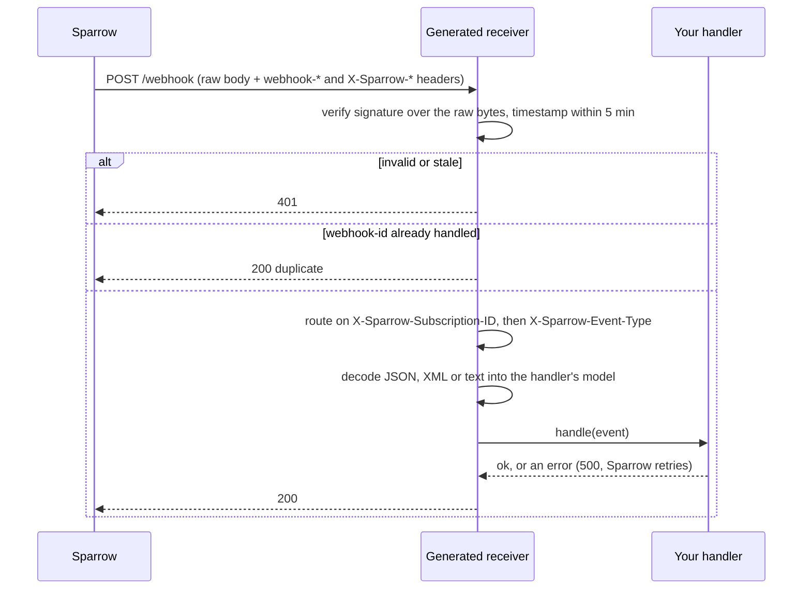

import { Tabs, TabItem, Aside } from '@astrojs/starlight/components';

Sparrow can write the receiving side of a webhook for you: a small project in
**Go** (`net/http`), **Python** (FastAPI) or **Node.js** (Express, TypeScript)
that verifies every delivery, routes each event to its own handler, decodes the
body into a model and ships with passing tests. You put your logic in the
handler stubs.

It is generated from the webhook itself: its signing scheme, its subscriptions,
their event types (schema and sample payload) and their transform templates.
Consumers generate it in the portal, operators on the webhook page, developers
with `sparrow scaffold` and coding agents through `sparrow mcp`. All four use
the same endpoint, `POST /v1/consumers/{consumer}/webhooks/{webhook_id}:generateReceiverCode`.

## What you get

| File (Go / Python / Node) | What it does |
|---|---|
| `receiver.go` / `receiver.py` / `src/receiver.ts` | Verifies, deduplicates, routes and decodes. You rarely need to touch it. |
| `handlers.go` / `handlers.py` / `src/handlers.ts` | One stub per subscription, marked `TODO: your logic`. |
| `models.go` / `models.py` / `src/models.ts` | Types for each body, from the event type's JSON Schema or a rendered sample. |
| `signature/signature.go` / `sparrow_verify.py` / `src/sparrow-verify.ts` | A byte-for-byte copy of Sparrow's tested [verification helper](/sparrow/guides/verify-signatures/). Do not edit it. |
| `receiver_test.go` / `test_receiver.py` / `test/receiver.test.ts` | Replays `testdata/spec.json`, a set of signed requests. |
| `README.md`, `.env.example`, `go.mod` / `requirements.txt` / `package.json` | How to run, test, configure and deploy it, with pinned dependency versions. |

Your webhook secret is never written into the project: the receiver reads it
from `SPARROW_WEBHOOK_SECRET`. For an Ed25519 webhook the public key is
embedded, since it is public; `SPARROW_WEBHOOK_PUBLIC_KEY` overrides it.

## How a delivery is handled



1. **Verify first, on the raw body.** The signature covers the bytes exactly as
   sent, so the receiver checks it before parsing anything, whatever the body
   format. A `webhook-timestamp` more than 5 minutes off is rejected as a
   possible replay (`Tolerance` / `TOLERANCE_SECONDS`).
2. **Deduplicate.** `webhook-id` stays the same on every retry of a delivery.
   The receiver remembers the last 10,000 it handled (`DedupCapacity` /
   `DEDUP_CAPACITY`, 0 turns it off). A delivery is remembered only after its
   handler succeeds, so a failed attempt is processed again when Sparrow
   retries it. The memory is per process: with several instances, keep the IDs
   in a shared store such as your database.
3. **Route on headers, never on the body.** A transform can drop the event name
   from the body, so the receiver uses `X-Sparrow-Subscription-ID` and falls
   back to `X-Sparrow-Event-Type` (see the [routing headers](/sparrow/guides/verify-signatures/#routing-headers)).
   A verified delivery that no handler matches gets **422**, so it fails
   visibly in Sparrow instead of being dropped.
4. **Answer fast.** Sparrow waits for the response. Do slow work on a queue and
   acknowledge as soon as it is accepted. A handler error answers 500 and
   Sparrow retries; a body that does not match the model answers 400.

Each receiver also serves `GET /healthz`.

## Body formats and models

A subscription's body is the [envelope](/sparrow/reference/architecture/#default-webhook-body)
or, with a transform, whatever the template renders. The generator renders each
transform against the event type's sample payload and decides the format:

- the subscription's own `Content-Type` header, when it sets one (`json`,
  `xml` for `application/xml`, `text/xml` and `+xml`, anything else is text);
- otherwise what the rendered sample looks like.

| Body | Model |
|---|---|
| Envelope | Typed from the event type's JSON Schema (or, without one, from its sample). |
| JSON transform | Typed from the rendered sample: best effort, check it against the template. |
| XML transform | Go: `encoding/xml` structs from the sample. Python: an `ElementTree` element. Node: the XML text. |
| Text, or a template whose output can vary | The body as a string. |

Inference never fails the generation. A shape it cannot type (a `oneOf` of
different objects, an external `$ref`, a key Go cannot use as a field name)
becomes an untyped value with a comment saying why. A template with `{{if}}` or
`{{with}}` can render different shapes, so its body stays a string. A template
that does not render against the sample is listed in the spec and its body is
also a string. The README and the spec list every such note.

## Test mode and the spec

`testdata/spec.json` describes the receiver for tools: how it verifies and
routes, each handler's format and model, and the **test vectors**. For each
subscription they include a valid delivery, the same one again (a duplicate), a
tampered body, a wrong key, a stale and a future timestamp, a missing
signature, the event type fallback and, for Ed25519, a valid `v1a` next to an
invalid `v1` and the reverse. They are signed with throwaway credentials
derived from the webhook ID, never your real secret.

With `SPARROW_RECEIVER_TEST_MODE=1`, the receiver writes one JSON line per
handler call to stdout (`handler`, `subscription_id`, `event_type`,
`webhook_id`, `value`). It is off by default; Sparrow's own contract tests use
it to check every generated receiver as a running server.

## In the portal and the dashboard

Open the webhook (in the portal, an endpoint) and choose **Integrate**:

1. Pick Go, Node.js or Python. The project appears as a file list with a
   preview; copy a file, or **Download .zip**.
2. Run it with the commands shown, at the webhook's URL.
3. Press **Send test event** next to a subscription. Sparrow sends one signed
   delivery of the event type's sample, rendered through the subscription's
   transform, and shows the receiver's status, latency and error class.

A test event goes through the same signing, network policy and timeout as a
real delivery and carries `X-Sparrow-Test: true`. It is not recorded as a
delivery and never affects the endpoint's health or auto-disable. Each server
allows one test event per webhook every 2 seconds.

## With the CLI

<Tabs>
<TabItem label="From a webhook">

```bash
sparrow scaffold --webhook <webhook-id> --lang python --framework fastapi -o ./receiver
cd receiver && python -m venv .venv && . .venv/bin/activate && pip install -r requirements.txt
pytest
SPARROW_WEBHOOK_SECRET=whsec_... python receiver.py
```

With the receiver running at the webhook's URL, send it a test event per
subscription:

```bash
sparrow scaffold --webhook <webhook-id> --lang python --framework fastapi -o ./receiver --force --test
```

</TabItem>
<TabItem label="Offline">

No server needed: describe one event type with a JSON Schema, a sample payload
or a transform template.

```bash
sparrow scaffold --offline --schema order.schema.json --event-type order.paid \
  --signing hmac --lang go --framework nethttp -o ./receiver
```

</TabItem>
</Tabs>

`sparrow scaffold` refuses to overwrite existing files unless you pass
`--force`. See the [CLI reference](/sparrow/satellites/cli/#sparrow-scaffold).

## With a coding agent

`sparrow mcp` offers `generate_receiver_code` (read-only): give it a webhook,
a language and a framework, and it returns the files, the spec and the run and
test commands. Ask the agent to fill in the handler stubs and keep the
verification helper as it is.

## Limitations

- Three targets: Go `net/http`, Python FastAPI and Node.js Express. Node runs
  the TypeScript directly, so it needs Node.js 22.18 or later.
- Models are best effort, from one schema or one rendered sample. Review them,
  especially for transforms.
- The dedup memory is per process. With more than one instance, replace it
  with a shared store.
- Sparrow does not host, deploy or store generated projects, and does not
  update them: generate again and merge what you want.
- The generator (`pkg/receivercode`) is **experimental**: the generated code
  can improve between releases. The endpoint itself follows the
  [compatibility policy](/sparrow/reference/compatibility/).
